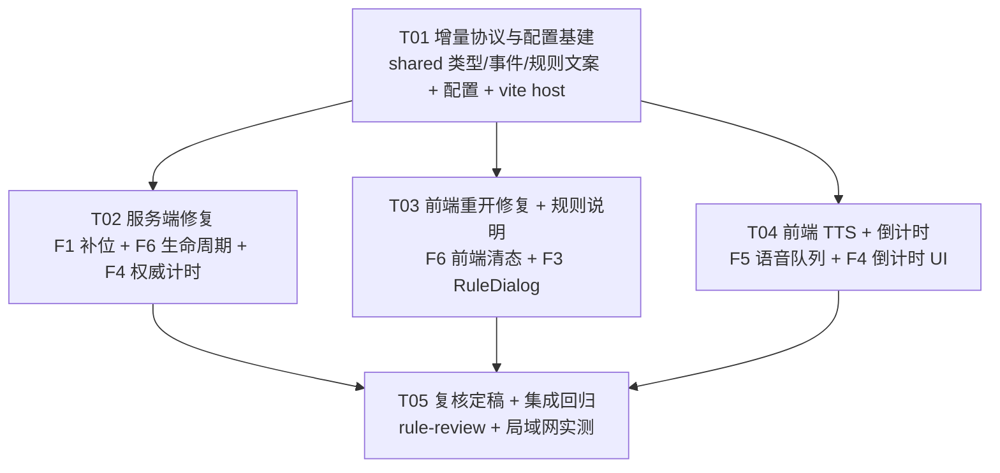

# 狼人杀 Demo 增量架构设计（迭代 2 · ARCHITECTURE-iter2.md）

> 版本：v2.0-incremental | 撰写人：高见远（架构师）| 日期：2026-11-13
> 上游输入：`docs/PRD-iter2.md` + 主理人齐活林 6 项拍板约束
> **本文件只描述增量变更**，全量设计以 `docs/ARCHITECTURE.md` v1.0 为基线；未提及的文件/协议一律不变。
> 所有结论均已对照迭代 1 实际源码核实（根因均给出 文件:行号）。

---

## Part A：六个变更点的实现方案

### A1. I-P0-2 局域网可玩（F2）——结论：前端已相对化，真因是 Vite dev 未绑 0.0.0.0

**源码核实**：
- 前端连接地址**已经全部是相对路径**：`client/src/api/socket.ts:23`（`io()` 默认同源）、`socket.ts:46-66`（REST 均 `/api/...` 相对路径）、`JudgeEngine.ts:772-773`（recordUrl 相对）。全仓 grep `localhost|127.0.0.1|http://` 在 `client/src` 零命中。**不存在"前端写死 localhost"问题**。
- 服务端已监听全部网卡：`server/src/index.ts:197`（`httpServer.listen(config.port)` 未指定 host，Node 默认绑 `::`/`0.0.0.0`）。
- **真正根因**：`client/vite.config.ts:7-20` 未设置 `server.host`，Vite dev 默认只绑定 `127.0.0.1` → 局域网第二台电脑根本连不上 5173 端口。

**实现方案（按拍板①）**：
1. `client/vite.config.ts`：`server` 段增加 `host: '0.0.0.0'`。`/api` 与 `/socket.io` 代理 target 保持 `localhost:3000`（这是主机本机进程间转发，不需要改）。
2. 前端 `api/socket.ts` 防御性加固：`io()` 显式传 `{ uri: undefined }` 语义注释即可，不改逻辑（禁止写死 localhost 的约束写进共享约定，防止后人回归）。
3. `README.md` 新增「局域网开黑指引」：查主机 IP（Windows `ipconfig`）→ 访问 `http://主机IP:5173` → **Windows 防火墙放行**（`控制面板 → 防火墙 → 高级设置 → 入站规则 → 新建规则 → 端口 5173/3000 TCP 允许`，或 `netsh advfirewall firewall add rule` 命令示例）→ 排查清单（同网段/IP 变动/防火墙/服务未启动）。
4. Docker/nginx 形态不受影响（nginx.conf 已反代，无需改）。

### A2. I-P0-1 席位自动补满（F1）

**根因（源码定位）**：
- `RoomManager.ts:23-26`：`AI_FILL_COUNT = 4` 常量固定。
- `RoomManager.ts:100-104`：**建房时**就固定填入 4 个 AI，占座位 2~5。
- 后果一：仅 1 真人开局 → 房间共 5 人，**第 6 席空缺**（PRD F1 现象）。
- 后果二：第二真人 `addHuman`（`Room.ts:100-128` 取最小空闲座位）会拿到 **6 号座**，违背拍板⑥"真人按加入顺序坐 1、2 号位"。

**实现方案（按拍板⑥）**：
1. `RoomManager.ts`：建房时 AI 预览改为占 **3、4、5、6 号座**（跳过 2 号位，作为第二真人预留席）；`AI_ROSTER` 从 4 条**扩充到 6 条**（新增 2 个差异化 AI：名字/头像/性格，avatarId 对应 `client/src/components/avatars.ts` 补充 ai-5、ai-6 形象）。
2. `Room.startGame()` 前新增 `fillAI()`：按座位号顺序，把所有非真人空座用 `AI_ROSTER` 顺序补满到 `config.seatCount`（= ACTIVE_GAME_CONFIG.seatCount，禁止空位开局）。真人数量不变，真人座位不变（1、2 号）。
   - 1 真人 → 补 5 个 AI（2~6 号座）；2 真人 → 补 4 个 AI（3~6 号座）。
3. 前端 `SeatGrid` 对空座（真人预留席）渲染"等待真人加入"占位态（迭代 1 已支持按 players 渲染，仅需空座占位样式）。

### A3. I-P0-4 同房间再开一局（F6）——根因分析 + 生命周期模型

**根因（源码定位，主因在前端）**：
1. **RC1（前端主因）**：`client/src/state/GameContext.tsx:141-142` reducer 的 `case 'view'` 只更新 `view`，**不清除 `gameOver` 及全部会话级状态**。而 `GamePage.tsx:80` 胜负弹窗 `open={gameOver !== null}`、`GamePage.tsx:32` `showStart = phase===LOBBY && isHost && !gameOver` → 房主点「同房重开一局」后服务端把 phase 广播回 LOBBY，但前端 `gameOver` 仍是旧值：**胜负弹窗永不关闭、「开始游戏」按钮永不出现**，新局卡死——这就是用户看到的"再开一局失败"。同理 `judgeMessages / deaths / checkResults / wolfTeammates / witchInfo / voteResult / lastWordsSeat` 全部残留（PRD 验收"旧局数据不残留"也不会过）。
2. **RC2（服务端次因）**：`Room.restart()`（`Room.ts:313-334`）只做了状态字段清零 + 重建 JudgeEngine，但：
   - 房间**没有生命周期状态机**，唯一的守卫是 `state.started` 布尔（`Room.ts:84-86`）；
   - restart 后**不自动开局**（靠前端再点开始——恰好被 RC1 挡死），也无显式"回大厅"事件通知前端清态；
   - `server/src/index.ts:185-188` 的 `game:restart-request` 处理器无任何状态校验；且协议上 `game:start` 在 `GAME_OVER` 后也未拦截——旧引擎 `running=false`（`JudgeEngine.ts:138-144`），直接 `engine.start()` 会在**未重置的状态**上二次 `dealCards`（双路径隐患）。
3. PhaseGate/timers：`game:over` 时旧引擎主循环已自然退出（`JudgeEngine.ts:241-249`），无悬挂计时器——排除该嫌疑。

**实现方案（按拍板④的正确生命周期模型）**：
1. **房间生命周期三态** `RoomStatus = 'WAITING' | 'RUNNING' | 'FINISHED'`（Room 内部字段，随 `state:sync` 暴露 `roomStatus` 到 GameStateView）：
   - `WAITING`：大厅（开局前）；`RUNNING`：对局中；`FINISHED`：胜负已分（game:over 后）。
2. **restart 语义增强为原子重开**：`Room.restart()` 仅允许 `FINISHED` 状态调用（`RUNNING` 拒绝、错误码 2003），执行顺序：`record.reset()` → 重置 GameState（dayNumber=0 / phase=LOBBY / 清 speeches/votes/nights/winner，players 保留成员名单、role/alive/roleRevealed 归零）→ 重建 JudgeEngine → **广播新事件 `game:restart`** → **立即 `engine.start()` 直接发牌开新局**（满足 PRD 验收"点击再开一局→新一局正常从发牌开始"，且消除"回大厅卡死"路径）。
3. `rejoinToken` 与 sockets 绑定**不销毁**（restart 不动 `rejoinTokens` / `sockets` Map），断线重连、双标签、免刷新进新局自然成立（PRD 验收 3）。
4. `game:start` 处理器增加守卫：仅 `WAITING` 可开局（`FINISHED` 状态发 `game:start` 返回 `{ok:false, error:'请先重开一局'}`，封死双路径）。
5. **前端清态**：GameContext 新增 reducer case `gameRestart`（收到 `game:restart` 时清空 gameOver/judgeMessages/deaths/checkResults/wolfTeammates/witchInfo/voteProgress/voteResult/typingSeats/lastWordsSeat），胜负弹窗随之关闭；另加兜底：收到 `phase===LOBBY && winner===null` 的 `state:sync` 也清 `gameOver`。

### A4. I-P0-3 规则复核 + 规则说明入口（F3）

**实现方案**：
1. **规则说明文案唯一数据源**：新增 `shared/src/rulesText.ts`（静态结构化文案：板子配置 6 人局 2狼+预言家+女巫+2平民、夜晚睁眼顺序（狼→验→药）、女巫三条规则——**明确"女巫全程不可自救，包括首夜"**/不可同夜双药/解药已用后不再告知刀口、遗言规则（仅首夜死者有遗言+放逐者有遗言）、平票 PK 与再平票平安日、屠城胜负）。文案与 PRD.md §2.3 表述严格一致；前端 RuleDialog 只渲染数据、不自带文案。
2. **前端入口**：新增 `client/src/components/RuleDialog.tsx`；`LobbyPage.tsx` 与 `GamePage.tsx` 顶栏各加 ⓘ 按钮。
3. **全量规则复核**：产出 `docs/rule-review.md`（规则条目 → 代码位置 → 结论），条目映射（复核时逐条核对并记录行号）：
   | 规则条目 | 代码位置 |
   | --- | --- |
   | 女巫不可自救 / 同夜双药 / 解药后不告知刀口 | `server/src/game/rules.ts:19-48` witchConstraints、`JudgeEngine.ts:368-391` stageWitch、`Room.ts:295-303` 视图裁剪 |
   | 狼人协同刀/空刀 | `rules.ts:51-60` arbitrateWolfKill、`gameConfig.ts:72` allowEmptyKnife |
   | 预言家验人 | `JudgeEngine.ts:345-365` stageSeer |
   | 遗言（仅首夜死者 + 放逐者） | `JudgeEngine.ts:529-536`（firstNightLastWordsOnly）、`JudgeEngine.ts:729-750`（放逐者遗言） |
   | 平票 PK / 再平票平安日 | `rules.ts:102-114` resolveTally、`JudgeEngine.ts:638-669` |
   | 屠城胜负 | `rules.ts:117-131` checkWin |
   | 夜晚顺序/发牌 | `JudgeEngine.ts:252-281` dealCards、`gameConfig.ts:66` nightOrder |
   初核结论：女巫边界、屠城、PK、遗言逻辑与 PRD 一致（具体行号在复核清单中定稿）；若复核发现偏差，在 T05 中一并修复并回写清单。
4. QA 按 PRD.md §5-3 三条女巫边界回归（同夜双药拒、首夜自救拒、解药后不告知刀口）。

### A5. I-P1-1 真人发言限时（F4）——服务端权威计时（按拍板⑤）

**实现方案**：
1. `server/src/config.ts`：`speech` 段新增 `timeLimitMs: numEnv('SPEECH_TIME_LIMIT_MS', 60_000)`（**不受 SPEED_MODE 倍率影响**——它是玩法时长不是演示节奏）。
2. `JudgeEngine.runDaySpeeches()`：真人发言等待改为 `Promise.race([waitForSpeech(seat), timeout])`——超时 resolve 空串即视为"过"，现有代码 `if (content)` 天然不广播空发言，流程继续下一环节，游戏不卡死；超时写 `record.logTimeline('X 号发言超时，视为过')`。AI 发言不受影响（无时限）。
3. **倒计时起点同步**：`GameStateView` 新增可选字段 `speechDeadlineMs?: number | null`——轮到真人发言时由服务端写入 `Date.now() + timeLimitMs` 并随现有 `syncViews()`（`currentSpeakerSeat` 切换时本来就会推）下发；非发言轮为 null。**不新增独立事件**（复用现有视图推送，断线重连后倒计时也能恢复）。`phase:change` 的 `deadline` 字段保持现状（夜间无限等待）。
4. 前端：`ActionArea.tsx` 附近新增倒计时条（以 `speechDeadlineMs` 与本地时钟差计算，每秒刷新；服务端归零判定为准，前端倒计时仅展示，**前端不做归零强制提交**，避免时钟漂移误判）。

### A6. I-P1-2 AI 语音播报（F5）+ 法官播报配音（按拍板②③）

**实现方案（纯前端，服务端零改动）**：
1. **TTS 引擎抽象**（预留 I-P2-1 云端 TTS 扩展点）：新增 `client/src/speech/tts.ts` 定义 `TTSEngine` 接口（`speak(text, voiceProfile): Promise<void>` / `cancel()` / `supported: boolean`）+ `WebSpeechTTSEngine` 实现（`window.speechSynthesis`）；未来云端 TTS 只需新增实现类替换。
2. **播放仲裁队列**（拍板③）：`SpeechQueue` 单例——**同一时刻只播一条，串行排队不重叠**；AI 发言（`speech:new` 且 `isAI`）与法官播报（`judge:say`，可选开关**默认关**）统一入队；整句播报（speech:new 事件携带完整文本，天然满足拍板②，不做流式 TTS）。
3. **音色映射表**：新增 `client/src/speech/voiceMap.ts`——`avatarId → { voiceURI?, pitch, rate }`（ai-1~ai-6 各一组可明显区分的 pitch/rate 组合，zh-CN voice 优先选择；映射表为唯一音色真相源）。
4. **开关与持久化**：AI 自动播报开关（默认开）、法官播报配音开关（默认关），localStorage 持久化（key：`werewolf-tts-enabled` / `werewolf-judge-tts-enabled`），断线重连后保留；开关 UI 挂在 `SettingsDialog.tsx`（不新增弹窗）。
5. **自动播放策略解锁**：首次用户手势（任意 click）后解锁 speechSynthesis；`SpeechFeed.tsx` 每条 AI/法官发言加 🔊 重播按钮（点击即入队播放该条）。
6. **降级**：`supported === false` 时全部静默跳过（纯文字照常），游戏流程不受影响；`speechSynthesis` 异常 try/catch 吞掉。

---

## Part B：增量文件清单（相对路径，标 注新增/修改）

| 文件 | 变更 | 说明 |
| --- | --- | --- |
| `shared/src/events.ts` | 修改 | 新增 `game:restart` 事件与 payload；GameStateView 增 `speechDeadlineMs` 说明注释 |
| `shared/src/types.ts` | 修改 | `GameStateView` 增可选字段 `roomStatus`、`speechDeadlineMs` |
| `shared/src/rulesText.ts` | **新增** | 规则说明文案唯一数据源 |
| `server/src/config.ts` | 修改 | `speech.timeLimitMs`（SPEECH_TIME_LIMIT_MS，默认 60000） |
| `server/src/room/RoomManager.ts` | 修改 | AI_ROSTER 扩至 6、建房 AI 占 3-6 号座、startGame 前 fillAI、game:start/restart 状态守卫 |
| `server/src/room/Room.ts` | 修改 | RoomStatus 生命周期、fillAI()、restart 原子重开 + 广播 game:restart、buildView 增 roomStatus/speechDeadlineMs |
| `server/src/game/JudgeEngine.ts` | 修改 | 真人发言超时"过"、发言轮 deadline 写入视图 |
| `server/tests/iter2-regression.test.ts` | **新增** | 补位满员 / 生命周期守卫 / 连续重开 / 发言超时单测 |
| `client/vite.config.ts` | 修改 | `server.host: '0.0.0.0'` |
| `client/src/state/GameContext.tsx` | 修改 | `gameRestart` 清态 case + LOBBY 兜底清 gameOver + speechDeadline 状态 + TTS 入队钩子 |
| `client/src/pages/GamePage.tsx` | 修改 | 胜负弹窗关闭逻辑、ⓘ 规则入口、倒计时区组装 |
| `client/src/pages/LobbyPage.tsx` | 修改 | ⓘ 规则入口 |
| `client/src/components/RuleDialog.tsx` | **新增** | 规则说明弹窗（渲染 shared/rulesText） |
| `client/src/components/SpeechCountdown.tsx` | **新增** | 发言倒计时条（每秒刷新，仅展示） |
| `client/src/components/SpeechFeed.tsx` | 修改 | AI/法官发言条目 🔊 重播按钮 |
| `client/src/components/SeatGrid.tsx` | 修改 | 真人预留席空座占位态 |
| `client/src/components/SettingsDialog.tsx` | 修改 | 两个 TTS 开关（AI 播报默认开 / 法官配音默认关） |
| `client/src/components/avatars.ts` | 修改 | 补 ai-5、ai-6 头像/性格 |
| `client/src/speech/tts.ts` | **新增** | TTSEngine 接口 + WebSpeechTTSEngine + SpeechQueue 串行仲裁 + 手势解锁 |
| `client/src/speech/voiceMap.ts` | **新增** | avatarId → 音色参数映射表 |
| `README.md` | 修改 | 「局域网开黑指引」章节 |
| `docs/rule-review.md` | **新增** | 规则复核清单（条目→代码位置→结论） |

---

## Part C：增量接口 / 事件协议（补录 §4.3 协议表）

**Server → Client 新增**

| 事件 | Payload | 定向 | 说明 |
| --- | --- | --- | --- |
| `game:restart` | `{}` | 广播 | 房主重开成功：前端立即清空全部会话级状态并关闭胜负弹窗；紧随其后的 `state:sync`（phase=LOBBY）与开局播报即新局起点 |

**Server → Client 复用（字段级增量）**

| 事件/结构 | 增量 | 说明 |
| --- | --- | --- |
| `GameStateView` | `roomStatus?: 'WAITING'\|'RUNNING'\|'FINISHED'` | 房间生命周期（前端守卫用） |
| `GameStateView` | `speechDeadlineMs?: number \| null` | 当前真人发言轮的服务端权威截止时间戳（Date.now()+timeLimitMs）；非发言轮为 null；随现有 syncViews 下发，**不新增事件** |

**Client → Server：无新增事件**；`game:restart-request` 语义增强（服务端校验仅 FINISHED 可调，成功即原子重开）。

**配置增量**：`SPEECH_TIME_LIMIT_MS`（env，默认 60000）→ `server/src/config.ts` `speech.timeLimitMs`。

---

## Part D：增量任务列表（按依赖顺序）

| ID | 任务名 | Source Files | 依赖 | 优先级 |
| --- | --- | --- | --- | --- |
| **T01** | **增量协议与配置基建**：shared 增量类型/事件/规则文案数据源、服务端发言时长配置、Vite 局域网绑定、README 指引 | `shared/src/events.ts`、`shared/src/types.ts`、`shared/src/rulesText.ts`（新）、`server/src/config.ts`、`client/vite.config.ts`、`README.md` | 无 | P0 |
| **T02** | **服务端修复三连**（F1 补位 + F6 生命周期 + F4 权威计时）：RoomStatus 状态机、fillAI、原子重开、发言超时"过"、状态守卫、回归单测 | `server/src/room/RoomManager.ts`、`server/src/room/Room.ts`、`server/src/game/JudgeEngine.ts`、`server/tests/iter2-regression.test.ts`（新） | T01 | P0 |
| **T03** | **前端重开修复 + 规则说明**（F6 前端 + F3）：gameRestart 清态、弹窗关闭、RuleDialog + 双入口、SeatGrid 空座占位 | `client/src/state/GameContext.tsx`、`client/src/pages/GamePage.tsx`、`client/src/pages/LobbyPage.tsx`、`client/src/components/RuleDialog.tsx`（新）、`client/src/components/SeatGrid.tsx` | T01 | P0 |
| **T04** | **前端 TTS + 倒计时 UI**（F5 + F4 前端）：TTSEngine/SpeechQueue/voiceMap、重播按钮、双开关、倒计时条 | `client/src/speech/tts.ts`（新）、`client/src/speech/voiceMap.ts`（新）、`client/src/components/SpeechFeed.tsx`、`client/src/components/SpeechCountdown.tsx`（新）、`client/src/components/SettingsDialog.tsx`、`client/src/components/avatars.ts` | T01（与 T03 并行，仅通过 GameContext 的入队钩子对接，接口已在 T01 冻结） | P1 |
| **T05** | **规则复核定稿 + 增量集成回归**：复核清单定稿（不一致即修 rules）、e2e 场景补位/连续重开、局域网双机实测、PRD §5 1-6 全量回归 | `docs/rule-review.md`（新）、`server/src/game/rules.ts`（仅当复核发现偏差）、`server/scripts/e2e-sim.ts`、T02/T03/T04 集成性小修 | T02, T03, T04 | P0 |

### 任务依赖图

---

## Part E：共享约定补充（给工程师的跨文件约定）

1. **规则说明文案唯一真相源**：`shared/src/rulesText.ts`；前端 RuleDialog 只渲染该数据，**禁止在组件里写规则文案**（防止文案与 PRD 漂移）。
2. **TTS 映射表唯一真相源**：`client/src/speech/voiceMap.ts`（avatarId → pitch/rate/voiceURI）；音色调整只改此文件；开关持久化 key 固定 `werewolf-tts-enabled` / `werewolf-judge-tts-enabled`。
3. **播放仲裁**：全站一切语音（AI 发言 + 法官播报 + 重播）必须经 `SpeechQueue` 入队串行播放，**禁止任何调用点直接调用 speechSynthesis.speak**。
4. **发言倒计时权威在服务端**：`speechDeadlineMs` 是服务端时间戳，前端只做展示；前端倒计时归零**不得**自动提交发言（服务端超时判定自动"过"）；任何设备时钟偏差不参与逻辑判定。
5. **房间生命周期**：`game:start` 仅 WAITING、`game:restart-request` 仅 FINISHED；restart = reset + 立即开局，中间不停留在大厅；rejoinToken/sockets 绑定跨局永久有效直到房间销毁。
6. **事件命名**：新增事件继续遵守 `域:动作` 蛇式小写（`game:restart`），协议唯一实现源仍是 `shared/src/events.ts`。
7. **禁止回归红线**：客户端连接地址一律相对路径/同源推导，**禁止出现任何写死的 `localhost` / `http://IP`**；Vite proxy target 指向本机 server 不受此限。
8. **AI 补位**：席位数只认 `ACTIVE_GAME_CONFIG.seatCount`；真人按加入顺序占 1、2 号位；AI 从 `AI_ROSTER` 顺序补满空座；开局时强制满员（fillAI 是 startGame 的前置步骤）。

---

## Part F：待明确事项（UNCLEAR 与假设）

1. **2 号真人预留席的大厅展示**：本设计选了"建房时 AI 占 3-6 号座、2 号位预留"方案（保住大厅座位区有 AI 的既有观感，同时让第二真人拿到 2 号座）。若产品更倾向"建房时不放 AI、开局才补满"，仅影响 `RoomManager.createRoom` 与 SeatGrid 展示，其余设计不变。
2. **AI_ROSTER 扩充的两个新 AI**：名字/性格由我在方案中给出占位（如"快嘴"激进速攻型、"老学究"逻辑流），最终文案可由产品微调，不影响接口。
3. **重开是否保留复盘下载**：restart 会 `record.reset()`，上一局 JSON 将不可再下载（与"旧局数据不残留"一致）。若需"上局复盘仍可下载"，需把上局 record 归档为文件再重置——Demo 建议不做，留作未来扩展点。
4. **发言超时是否广播给全体**：本设计只在法官流水播"X 号发言超时，视为过"（judge:say，全员可见，与当面过 thread 一致）。若需静默超时，去掉一行日志即可。
5. **TTS 的 Edge/Chrome voice 差异**：voiceMap 的 voiceURI 留空时由浏览器自选 zh-CN 音色，pitch/rate 是主要区分手段（跨浏览器稳定）；实测若音色区分度不足，在 T05 微调映射表。
