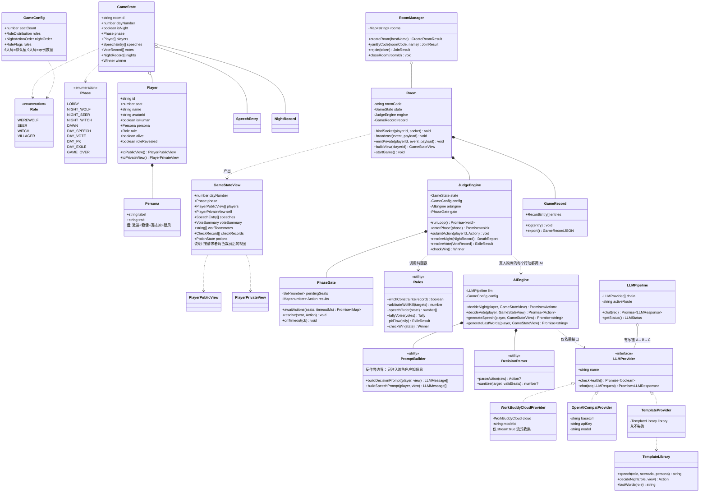
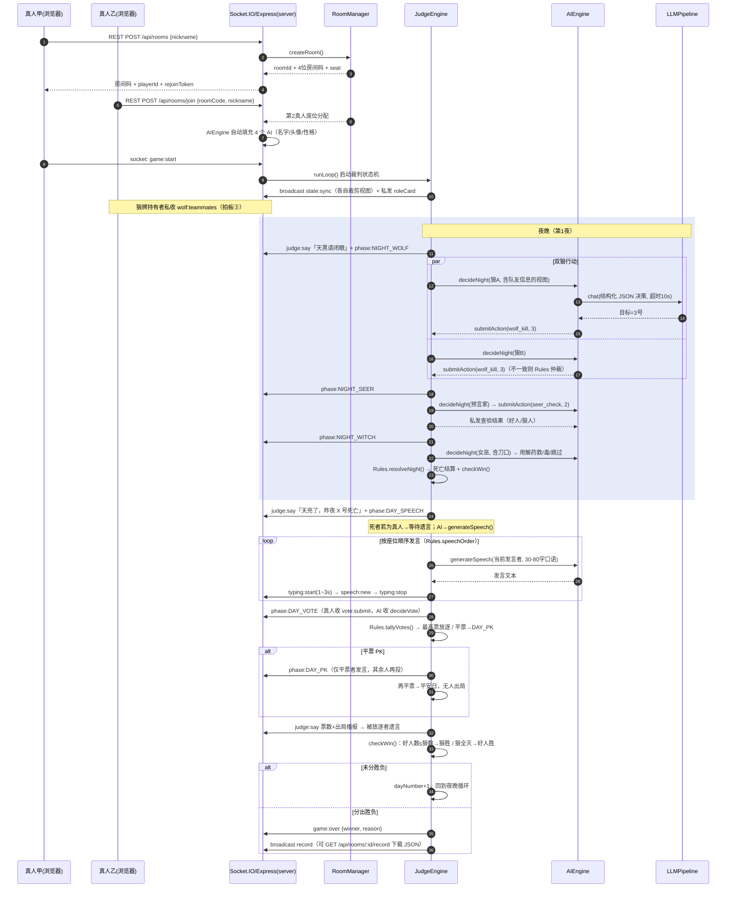
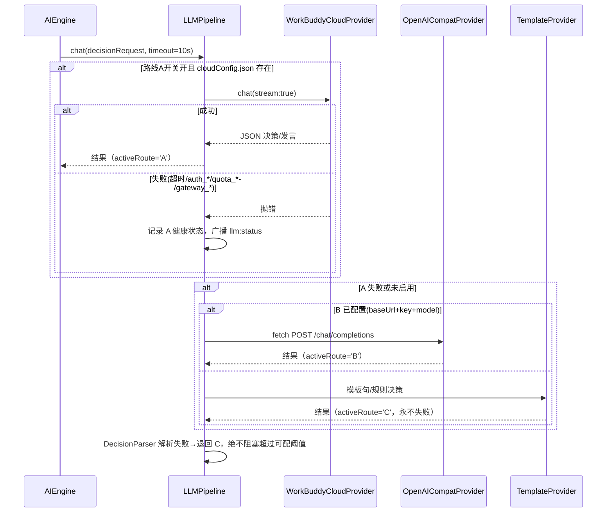
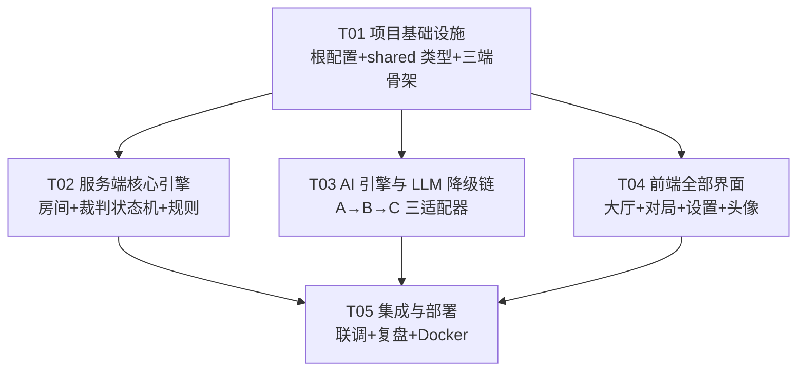

# 狼人杀 Demo 系统架构设计与任务分解（ARCHITECTURE.md）

> 版本：v1.0 | 撰写人：高见远（架构师）| 日期：2026-11-12
> 上游输入：`docs/PRD.md` v1.0 + 主理人齐活林的 6 项拍板约束

---

# Part A：系统设计

## 1. 实现方案 + 框架选型说明

### 1.1 核心技术挑战

1. **异步裁判状态机**：一局游戏是「夜晚 4 阶段 + 白天发言/投票/PK」的严格顺序流程，每一步要么等真人操作、要么等 AI 决策（带超时兜底），必须**永不卡死**。这是本项目最难的一点，采用**事件驱动 + Promise 化的阶段等待器（PhaseGate）**实现。
2. **信息隔离（反作弊边界）**：服务端是唯一权威状态源；推给每个客户端的是**按角色裁剪的状态视图（GameStateView）**，私密信息（狼队友/查验结果/刀口）只走定向 private 事件，绝不出现在广播里。
3. **LLM 三级降级链**：路线 A（WorkBuddy 免密钥）→ 路线 B（OpenAI 兼容）→ 路线 C（本地模板句库），任何一级失败在可配超时内自动降级，游戏流程不被阻塞。
4. **配置驱动可扩展**：6 人局板子只是 `gameConfig` 里的一条数据，9 人局 = 换一条配置（角色数组 + 夜晚行动顺序数组），规则引擎按配置行走，不硬编码。

### 1.2 框架与库选型（及理由）

| 层 | 选型 | 理由 |
| --- | --- | --- |
| 后端运行时 | **Node.js 20 + TypeScript** | 前后端同语言，`shared/` 类型可直接复用；AI 调用天然异步 I/O，单进程足够支撑 1 局 Demo |
| HTTP | **Express 4** | 轻量成熟，承担 REST（建房/加入/设置/复盘下载），Socket.IO 可与其共享同一 HTTP server |
| 实时通信 | **Socket.IO 4**（而非裸 WebSocket） | 内置 room 概念（一个房间 = 一个 Socket.IO room，天然隔离广播）、自动重连（P1-5 断线重连免费获得）、ack 回调机制（join/投票等操作可直接 ack） |
| LLM 路线 A | **`@tencent-ai/workbuddy-cloud-sdk@dev`**（npm 形式，server 端 Node 调用） | 官方唯一正式 SDK；`stream:true` 流式收集 + `response_format:{type:'json_object'}` 做结构化决策输出；客户端必须以激活云服务返回的 `publicConfig.endpoint + publishableKey` 初始化，**运行时从本地 `cloudConfig.json` 读取，不硬编码、不进环境变量、不进 git** |
| LLM 路线 B | 原生 `fetch` 调 OpenAI 兼容 `/chat/completions` | Node 20 自带 fetch，无需引 openai SDK，减少依赖面；baseURL/key/model 全部可配 |
| 前端构建 | **Vite 5 + React 18 + TypeScript** | 主理人指定基线；HMR 快、Docker 构建产物为纯静态文件 |
| UI 组件 | **MUI 5**（对话框/按钮/进度条等） + **Tailwind CSS 3**（布局与自定义样式） | MUI 提供现成交互组件保证可用性；Tailwind 负责座位网格、夜间遮罩等游戏化布局，两者搭配为主理人指定基线 |
| 状态管理（前端） | **React Context + useReducer** | 单局游戏状态由服务端推送驱动，本地无复杂派生逻辑，不上 Redux/Zustand |
| 进程编排 | **Docker Compose 2**（server 容器 + client/nginx 容器） | 一键起：`docker compose up`；client 容器用 nginx 托管静态文件并反代 `/socket.io` 与 `/api` 到 server，两台设备走局域网 IP 即可游玩 |

### 1.3 架构模式

- **服务端权威 + 单向数据流**：所有游戏状态只存在于 server 的 `GameState`，客户端永远只渲染收到的 `GameStateView`，客户端不发状态、只发意图（action）。
- **分层**：`接入层（Express + Socket.IO）→ 房间层（RoomManager/Room）→ 引擎层（JudgeEngine 状态机 + Rules 规则）→ 智能层（AIEngine + LLMPipeline 三级降级）`。层间只依赖接口（`LLMProvider` 接口、`GameConfig` 配置）。
- **裁判引擎模式**：`JudgeEngine` 是一个显式阶段状态机（`LOBBY → NIGHT_WOLF → NIGHT_SEER → NIGHT_WITCH → DAWN → DAY_SPEECH → DAY_VOTE → DAY_PK? → DAY_EXILE → NIGHT... → GAME_OVER`），每个阶段通过 `PhaseGate` 等待全部存活玩家的行动（真人 = socket 上行事件，AI = AIEngine 异步返回），收集齐/超时后由 `Rules` 计算下一状态并广播。

### 1.4 主理人 6 项拍板的落地方式

| 拍板 | 落地 |
| --- | --- |
| ① LLM A→B→C | `LLMPipeline` 持有有序 Provider 列表，逐级尝试；A 的启用由 `llm.routeA.enabled` 开关 + `cloudConfig.json` 是否存在共同决定；A 失败（超时/auth/quota）记入健康状态并自动切 B，B 未配置或失败切 C；C 永不失败 |
| ② 4 位房间码 | 建房 REST 返回 4 位码；第二位真人在大厅输码加入；房间码即简易鉴权，无账号系统；同时发 rejoin token 供断线重连 |
| ③ 狼人互知 | 发牌后立即给每张狼牌定向推 `wolf:teammates`；AI 狼 prompt 注入队友座位；双狼刀口：各自提交目标，若不一致由引擎仲裁（随机取狼方提交之一），对真人狼界面展示队友 + "队友正在决策" |
| ④ AI 发言节奏 | 模板要求 30-80 字口语化；AIEngine 播报前 `delay(1~3s 随机)` + 前端"打字中"动效；所有延迟/超时集中在 `server/src/config.ts` 可配（含"极速模式"倍率） |
| ⑤ 复盘 JSON | `GameRecord` 全程记录（刀口/查验/用药/发言全文/投票明细/胜负），结束后 `GET /api/rooms/:id/record` 下载 JSON（P1） |
| ⑥ AI 头像 | `client/src/components/avatars.ts` 内置 emoji+SVG 形象集（含名字/性格标签），发牌时随机分配，预留 image 字段后续替换 |

## 2. 文件列表（完整相对路径）

```
werewolf-demo/
├── package.json                        # 根：npm workspaces + 通用脚本
├── tsconfig.base.json                  # 根：共享 TS 编译基线
├── .gitignore                          # 忽略 cloudConfig.json / data/ / dist/
├── README.md                           # 本地运行 & Docker 一键启动说明
├── docker-compose.yml                  # server + client 双容器编排
├── Dockerfile.server                   # server 镜像（node:20-alpine，tsx 运行 TS）
├── Dockerfile.client                   # client 镜像（两段式：vite build → nginx 托管）
├── nginx.conf                          # 静态托管 + /api、/socket.io 反代
├── docs/
│   ├── PRD.md                          # （已有）
│   ├── ARCHITECTURE.md                 # 本文件
│   ├── class-diagram.mermaid
│   └── sequence-diagram.mermaid
├── shared/                             # 前后端共享，唯一类型真相源
│   ├── package.json
│   ├── tsconfig.json
│   └── src/
│       ├── index.ts                    # 统一导出桶
│       ├── types.ts                    # Player/Role/Phase/GameState/GameStateView/Action 等
│       ├── events.ts                   # Socket.IO 事件协议（ClientToServer/ServerToClient + payload 类型）
│       └── gameConfig.ts               # 6人局板子配置 + 9人局示例配置（数据化）
├── server/
│   ├── package.json
│   ├── tsconfig.json
│   └── src/
│       ├── index.ts                    # 入口：Express + Socket.IO 装配、静态托管 record
│       ├── config.ts                   # 全部可配置项（LLM 顺序/超时/延迟/开关，读 env + data/settings.json）
│       ├── security/secrets.ts         # 路线 B Key 的本地存储（0600 文件、日志脱敏、读取即掩码）
│       ├── room/RoomManager.ts         # 房间创建/房间码/加入/重连 token
│       ├── room/Room.ts                # 单房间：成员、socket 绑定、广播分发、角色视图裁剪
│       ├── game/JudgeEngine.ts         # 裁判状态机 + PhaseGate 阶段等待器（核心）
│       ├── game/phases.ts              # 阶段枚举、阶段→所需行动映射表（配置驱动）
│       ├── game/rules.ts              # 女巫边界/双狼仲裁/平票PK/屠城胜负判定/发言顺序
│       ├── game/GameRecord.ts          # 复盘记录器（P1）
│       ├── ai/AIEngine.ts              # AI 统一入口：决策(夜间/投票) + 发言生成 + 节奏延迟
│       ├── ai/promptBuilder.ts         # 按角色注入"应知信息"的 prompt 组装（反作弊边界在此收口）
│       ├── ai/decisionParser.ts        # LLM 输出 JSON 解析 + 非法值清洗
│       ├── llm/Provider.ts             # LLMProvider 接口 + LLMRequest/LLMResponse 类型
│       ├── llm/LLMPipeline.ts          # A→B→C 降级链、健康状态、llm:status 广播
│       ├── llm/WorkBuddyCloudProvider.ts   # 路线 A（workbuddy-cloud-sdk，Node 端）
│       ├── llm/OpenAICompatProvider.ts     # 路线 B（fetch OpenAI 兼容接口）
│       ├── llm/TemplateProvider.ts         # 路线 C（模板句库包装为 Provider）
│       ├── llm/templates.ts            # 按角色/场景的口语化模板句库 + 规则化决策
│       └── llm/cloudConfig.json        # （运行时生成，gitignore）WorkBuddy 云激活产物 endpoint+publishableKey
└── client/
    ├── package.json
    ├── tsconfig.json
    ├── vite.config.ts                  # dev 代理 /api、/socket.io → server
    ├── tailwind.config.js
    ├── postcss.config.js
    ├── index.html
    └── src/
        ├── main.tsx
        ├── App.tsx                     # 路由（大厅/对局），MUI ThemeProvider
        ├── api/socket.ts               # socket 单例 + 事件订阅封装
        ├── state/GameContext.tsx       # useReducer 管理服务端推送的 GameStateView
        ├── pages/LobbyPage.tsx         # 昵称输入 / 建房 / 输房间码加入 / 开始游戏
        ├── pages/GamePage.tsx          # 对局主页面（组装下方组件）
        ├── components/StatusBar.tsx    # 天数/昼夜/当前阶段/LLM 状态灯
        ├── components/JudgeAnnouncer.tsx # 法官播报区（🎩 样式）
        ├── components/SeatGrid.tsx     # 6 席网格：头像/昵称/AI标识/死亡置灰/打字中动效
        ├── components/RoleCard.tsx     # 本人身份牌 + 私密信息（狼队友/查验/用药）
        ├── components/NightPanel.tsx   # 夜间技能面板（狼刀/验人/用药三形态）+ 请闭眼遮罩
        ├── components/SpeechFeed.tsx   # 发言/事件流水区（滚动）
        ├── components/VotePanel.tsx    # 投票面板（PK 态只可选平票者）+ 已投票计数
        ├── components/ActionArea.tsx   # 操作区：发言输入/遗言输入 按阶段切换
        ├── components/SettingsDialog.tsx # 路线 B 配置（baseURL/Key/模型，Key 不回显）
        ├── components/GameRecordDialog.tsx # 复盘查看 + JSON 下载（P1）
        └── components/avatars.ts       # 内置 emoji/SVG 头像集（AI 名字+形象+性格标签）
```

## 3. 数据结构与接口（Mermaid 类图）



要点：
- `Rules` 是**纯函数集**（女巫约束、双狼仲裁、平票 PK、屠城判定、发言顺序），无状态、可单测——对应 PRD 验收要点 3/4。
- `JudgeEngine` 只依赖 `AIEngine` 的 Promise 接口与 `PhaseGate`，真人/AI 行动在引擎看来是同一种 `submitAction`，因此 LLM 全挂时 C 路线（模板决策）依然能走完流程。
- `GameStateView` 是信息隔离的关键：`Room.buildView(playerId)` 按角色裁剪，夜间私密字段只出现在该角色自己的视图与 private 事件里。

## 4. 程序调用流程（Mermaid 时序图）

### 4.1 一局游戏核心时序（建房→加入→夜晚→白天→投票→胜负）



### 4.2 LLM 三级降级时序



### 4.3 WebSocket 事件协议表（shared/src/events.ts 为唯一实现源）

**Client → Server**

| 事件 | Payload | ack 返回 | 说明 |
| --- | --- | --- | --- |
| `room:join-socket` | `{playerId, rejoinToken?}` | `{ok}` | REST 拿到身份后建立 socket 绑定；带 token 即断线重连（P1-5） |
| `game:start` | — | `{ok}` | 仅房主可发 |
| `action:night` | `{type:'wolf_kill'\|'seer_check'\|'witch_save'\|'witch_poison'\|'skip', targetSeat?}` | `{ok}` | 夜间行动，引擎校验该玩家当前阶段确有此权限 |
| `speech:submit` | `{content}` | `{ok}` | 白天发言（≤120字，前端限长） |
| `vote:submit` | `{targetSeat}` | `{ok}` | 投票/PK 投票（引擎校验候选范围） |
| `lastwords:submit` | `{content}` | `{ok}` | 遗言 |
| `game:restart-request` | — | `{ok}` | 结束后回大厅重开（同房） |

**Server → Client**

| 事件 | Payload | 定向 | 说明 |
| --- | --- | --- | --- |
| `state:sync` | `GameStateView` | 每连接（按角色裁剪） | 全量视图，任何不确定时前端以此为准 |
| `phase:change` | `{dayNumber, phase, isNight, deadline?}` | 广播 | 阶段切换；有 deadline 时前端显示倒计时 |
| `judge:say` | `{text}` | 广播 | 法官播报（天黑/死讯/票数/胜负） |
| `speech:new` | `{seat, name, avatarId, content, isAI}` | 广播 | 发言入流水区 |
| `typing:start` / `typing:stop` | `{seat}` | 广播 | AI"打字中"动效（1-3s） |
| `death:announce` | `{seats:number[], cause:'wolf'\|'poison'\|'exile'}` | 广播 | 死讯（死因是否公开按规则：狼刀/毒死/放逐区分播报） |
| `check:result` | `{targetSeat, result:'WEREWOLF'\|'GOOD'}` | **私发（预言家）** | 查验结果，永不出现在广播 |
| `wolf:teammates` | `{seats:number[]}` | **私发（狼人）** | 狼队友揭示（拍板③） |
| `witch:info` | `{knifeTargetSeat?\|null, potions}` | **私发（女巫）** | 解药未用时才告知刀口 |
| `vote:progress` | `{votedCount, totalVoters}` | 广播 | 已投票人数（不显示投给谁） |
| `vote:result` | `{tally:{seat,count}[], exiledSeat?\|null, isPK}` | 广播 | 投票结果 |
| `llm:status` | `{activeRoute:'A'\|'B'\|'C', message}` | 广播 | 顶栏 LLM 状态灯 |
| `game:over` | `{winner:'WEREWOLF'\|'VILLAGER', reason, recordUrl}` | 广播 | 胜负 + 复盘下载地址 |
| `game:restart` | `{}`（恒为空对象，不含任何私密字段） | 广播 | 房主重开成功（迭代2 F6）：前端立即清空全部会话级状态并关闭胜负弹窗；紧随其后的 `state:sync` 与开局播报即新局起点 |
| `settings:updated` | `LLMSettingsView`（掩码设置视图） | 广播 | 设置变更后通知前端刷新（路线 A 开关/路线 B 配置） |

**REST API（Express，非实时操作）**

| 方法/路径 | 说明 |
| --- | --- |
| `POST /api/rooms` | 建房 `{nickname}` → `{roomId, roomCode, seat, playerId, rejoinToken}` |
| `POST /api/rooms/join` | 输码加入 `{roomCode, nickname}` → 同上（房间码即鉴权） |
| `GET /api/settings` / `POST /api/settings` | LLM 路线 A 开关 + 路线 B 配置（Key 只写不读，GET 返回掩码） |
| `GET /api/rooms/:id/record` | 复盘 JSON 下载（P1-2） |
| `GET /api/health` | 容器健康检查 |

## 5. 待明确事项（UNCLEAR 与假设）

1. **路线 A 在本地 Docker 的 Origin 校验**：云服务鉴权含 Origin/domain 允许名单，本地容器场景（浏览器经 nginx 访问、服务端 Node 直接调数据平面）的匹配行为**必须在云服务激活后实测**。已按主理人拍板把 A 做成可配置开关 + 失败自动切 B，`LLMPipeline` 健康状态会广播到前端状态灯，实测若 A 不可用不影响可玩性（C 路线零配置保底）。激活产物写入 `server/src/llm/cloudConfig.json`（gitignore，不硬编码）。
2. **真人行动是否设超时**：Demo 默认**不设**（法官无限等待真人），避免误杀体验；`config.humanActionTimeoutMs` 预留，设了则超时按"跳过/弃票"处理。
3. **双狼刀口仲裁细节**：采用 PRD 建议的引擎仲裁——两狼目标一致即用之，不一致则随机取狼方提交之一；不做"商量轮次"（简单且对真人狼公平）。
4. **AI 狼是同阵营 2 狼时的信息注入**：prompt 各自注入队友座位，但**不**互相共享对方 prompt 的完整推理，防串话。
5. **死亡播报是否公布死因**：采用"狼刀死亡公布、毒死也公布为夜间死亡（不指明是毒）、放逐公布"——即只说"夜里死了"，不区分刀/毒，符合通用玩法；如客户要求区分，改 `Rules` 一处即可。
6. **路线 B Key 的加密级别**：本地文件 + 0600 权限 + 掩码回显 + 日志脱敏；不引入系统级加密依赖（Demo 权衡），写入位置 `server/data/settings.json`（volume 持久化）。
7. **WebSocket 传输在企业内网的兼容性**：Socket.IO 自带 polling 降级，nginx 反代需配 upgrade 头（已写入 nginx.conf 设计）。

---

# Part B：任务分解

## 6. 依赖包列表

**根 / shared**
```
- typescript@^5.4.0: 全仓 TS
- npm workspaces: server/client/shared 三包联编
```

**server**
```
- express@^4.19.0: REST API
- socket.io@^4.7.0: 实时事件
- @tencent-ai/workbuddy-cloud-sdk@dev: 路线 A 免密钥 LLM（npm 形式，带构建步骤项目；禁用 @latest/固定版本）
- zod@^3.23.0: 配置/LLM 输出校验
- tsx@^4.10.0: TS 直跑（容器内免编译）
- dev: @types/express, @types/node, vitest@^2.0.0（Rules 纯函数单测）
```

**client**
```
- react@^18.2.0, react-dom@^18.2.0: UI 框架
- @mui/material@^5.14.0, @emotion/react, @emotion/styled: 组件库
- socket.io-client@^4.7.0: 实时客户端
- tailwindcss@^3.4.0, postcss, autoprefixer: 样式
- vite@^5.2.0, @vitejs/plugin-react: 构建
- typescript@^5.4.0
```

**部署**
```
- Dockerfile.server（node:20-alpine）
- Dockerfile.client（node build → nginx:alpine）
- docker-compose.yml（server + client，client nginx 反代 /api 与 /socket.io）
```

## 7. 任务列表（按依赖顺序，共 5 个）

> 硬约束：≤5 个任务；T01 必须是项目基础设施；每任务 ≥3 个文件；任务尽量只依赖 T01，避免长链。

| ID | 任务名 | Source Files | 依赖 | 优先级 |
| --- | --- | --- | --- | --- |
| **T01** | **项目基础设施**：根 workspace 配置、共享类型与事件协议、游戏配置数据化、三端骨架入口 | `package.json`、`tsconfig.base.json`、`.gitignore`、`README.md`、`shared/package.json`、`shared/tsconfig.json`、`shared/src/index.ts`、`shared/src/types.ts`、`shared/src/events.ts`、`shared/src/gameConfig.ts`、`server/package.json`、`server/tsconfig.json`、`server/src/index.ts`、`server/src/config.ts`、`client/package.json`、`client/tsconfig.json`、`client/vite.config.ts`、`client/tailwind.config.js`、`client/postcss.config.js`、`client/index.html`、`client/src/main.tsx`、`client/src/App.tsx` | 无 | P0 |
| **T02** | **服务端核心引擎**：房间管理（房间码/加入/重连）、裁判状态机（JudgeEngine+PhaseGate）、规则纯函数集、复盘记录 | `server/src/room/RoomManager.ts`、`server/src/room/Room.ts`、`server/src/game/JudgeEngine.ts`、`server/src/game/phases.ts`、`server/src/game/rules.ts`、`server/src/game/GameRecord.ts`、`server/src/security/secrets.ts`（+ `rules` 的 vitest 单测文件） | T01 | P0 |
| **T03** | **AI 引擎与 LLM 三级降级链**：Provider 接口 + A/B/C 三适配器 + Pipeline + PromptBuilder（反作弊注入）+ 决策解析 + 模板句库 | `server/src/llm/Provider.ts`、`server/src/llm/LLMPipeline.ts`、`server/src/llm/WorkBuddyCloudProvider.ts`、`server/src/llm/OpenAICompatProvider.ts`、`server/src/llm/TemplateProvider.ts`、`server/src/llm/templates.ts`、`server/src/ai/AIEngine.ts`、`server/src/ai/promptBuilder.ts`、`server/src/ai/decisionParser.ts` | T01（接口上仅依赖 shared 类型；与 T02 通过 AIEngine 接口约定并行开发） | P0 |
| **T04** | **前端全部界面**：大厅/对局页、状态栏、法官区、座位区、身份牌、夜间技能面板、发言流水、投票面板、操作区、设置弹窗、头像集 | `client/src/api/socket.ts`、`client/src/state/GameContext.tsx`、`client/src/pages/LobbyPage.tsx`、`client/src/pages/GamePage.tsx`、`client/src/components/StatusBar.tsx`、`JudgeAnnouncer.tsx`、`SeatGrid.tsx`、`RoleCard.tsx`、`NightPanel.tsx`、`SpeechFeed.tsx`、`VotePanel.tsx`、`ActionArea.tsx`、`SettingsDialog.tsx`、`GameRecordDialog.tsx`、`avatars.ts` | T01（可先以 shared 事件类型 + mock 事件流开发） | P0 |
| **T05** | **集成与部署**：前后端 socket/REST 联调、LLM 开关与降级实测、复盘下载、Docker 双容器一键起 | `docker-compose.yml`、`Dockerfile.server`、`Dockerfile.client`、`nginx.conf`、`server/src/llm/cloudConfig.json`（激活产物占位）、T02/T03/T04 的集成性小修 | T02, T03, T04 | P0（P1 项：复盘导出） |

## 8. 共享知识（给工程师的跨文件约定）

1. **类型真相源**：一切跨端类型/事件名**只**写在 `shared/src/types.ts` 与 `shared/src/events.ts`，server/client 通过 workspace 引用 import，禁止两端各自复制定义。
2. **事件命名**：Socket.IO 事件统一 `域:动作` 蛇式小写（`room:join-socket`、`action:night`、`speech:new`、`llm:status`…），与 §4.3 协议表严格一致。
3. **REST 返回格式**：统一 `{code:number(0=成功), data, message}`；错误码：1001 房间码无效 / 1002 房满 / 1003 房间已开局 / 2001 参数非法。
4. **状态权威**：客户端永远不持有真相，一切以收到的 `GameStateView`（`state:sync`）为准；私密信息只走 §4.3 标注"私发"的事件，**任何广播 payload 中禁止出现角色/刀口/查验字段**（QA 验收点 5）。
5. **LLM 约定**：所有 `chat.completions.create` 调用 `messages[0]` 必须是 system 消息（SDK 强制）；只支持 `stream:true`，决策类请求用 `response_format:{type:'json_object'}` + 流式拼接后 `JSON.parse`；超时（默认 10s，可配）由 `LLMPipeline` 统一 AbortController 实现。
6. **路线 A 凭据**：`endpoint` + `publishableKey` 只能来自云服务激活产物文件 `server/src/llm/cloudConfig.json`，**禁止硬编码/环境变量/URL 推导**；该文件进 `.gitignore`；缺失时 Provider A 直接报告不健康并跳过。
7. **安全红线**：路线 B API Key 存 `server/data/settings.json`（volume 持久化、0600），GET 接口只回掩码（`sk-****last4`），所有 logger 出口经 `secrets.ts` 脱敏；LLM 输出视为不可信文本，前端渲染前转义。
8. **目录约定**：`shared/`（纯类型与配置数据，无运行时依赖）→ `server/src/{room,game,ai,llm,security}` → `client/src/{pages,components,state,api}`；新增文件必须落进对应域目录。
9. **配置驱动**：板子/人数/夜晚顺序只改 `shared/src/gameConfig.ts` 的数据（9 人局作为第二个示例数据附上），规则引擎与 UI 按 `seatCount`/`roles` 数组渲染，出现写死 "6" 的引擎代码即 review 打回（数组长度除外）。
10. **节奏参数集中**：AI 思考延迟 1-3s、LLM 超时 10s、发言限长等全部进 `server/src/config.ts`（支持 env 覆盖 + `SPEED_MODE` 倍率），禁止散落魔法数字。

## 9. 任务依赖图



> 并行提示：T02/T03/T04 三个任务在 T01 完成后**可三人并行**（T03 与 T02 仅通过 `AIEngine` 接口签名对接，接口在 T01 的 shared 类型中已冻结）；T05 为汇合点。
